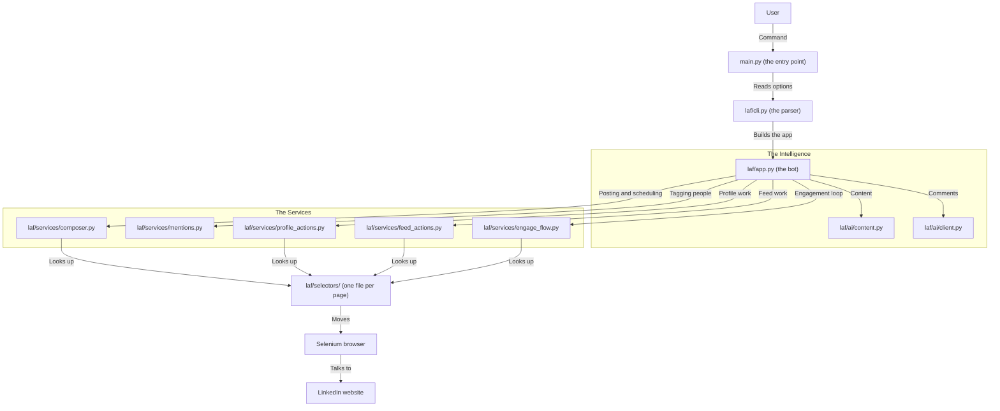

# LinkedIn Automation Framework (LAF)

## The Big Idea

LAF does the slow part of LinkedIn for you. It writes posts, reads your feed and
replies to people, using a real browser, so you can go and do your real work.

## What is LAF?

LAF is a Python tool that drives a real Chromium browser and does human-like
actions on LinkedIn. It uses the web page, not a private API, so it works the
same way a person does.

There is one command for posting, one for feed engagement, one for a single
profile, one for reposting, and one for a content calendar. Each command has its
own nickname below.

## Table of Contents

- [1. The Blueprint](#the-blueprint-how-it-works)
- [2. Feature Deep Dive](#feature-deep-dive-the-command-list)
- [3. Quick Start](#quick-start-run-it-in-60-seconds)
- [4. Global Switches](#global-switches)
- [5. Staying Safe](#staying-safe-safety--de-duplication)
- [6. The Map](#the-map-project-structure)
- [7. Evidence & Proof](#evidence--proof)
- [8. Documentation & Introspection](#documentation--introspection)
- [9. Troubleshooting](#troubleshooting)
- [10. Contributing](#contributing)
- [11. Security](#security)
- [12. Code of Conduct](#code-of-conduct)
- [13. License](#license)

---

## The Blueprint (How it Works)

This map shows where your command travels, from the keyboard to LinkedIn, and
which file handles each step.



---

## Feature Deep Dive (The Command List)

### 1. The "Ghost Writer" (`post`)

This command puts a post live. It handles text, image uploads and scheduling.

- Image sampling: give it a folder, and it picks images from that folder.
- Scheduling: set a date and time, and the post goes out later.
- Topics file: give it a file of ideas, and it picks one, posts it, and records
  that it was used.

Options:

- `--text "..."`: post this text now.
- `--topics-file topics.txt`: pick a topic from this file.
- `--images-dir ./static`: attach images from this folder.
- `--no-images`: skip images even when `--images-dir` is set.
- `--schedule-date "MM/DD/YYYY"` and `--schedule-time "HH:MM AM/PM"`: schedule
  the post instead of publishing it now.

### 2. The "Party Animal" (`engage`)

This command keeps your account active. It scrolls your feed and likes or
comments on posts.

- AI comments: writes comments from the post text with OpenAI.
- Human pacing: uses delays between actions.
- Skips promoted posts.

Options:

- `--action [like|comment|both]`: what to do on each post. Default is `both`.
- `--max-actions 10`: the most posts to touch in one run. Default is `10`.

### 3. The "Hunter" (`pursue`)

This command works on one person's profile to build a relationship.

- Bio filter: it only acts when the bio contains the keywords you give.
- Follow: it can follow the person after engaging with their posts.

Arguments and options:

- `profile_name`: the name to search for, given as a plain word or quoted name.
- `--max-posts 5`: the most posts to touch. Default is `5`.
- `--bio-keywords "investor" "startup"`: only act when the bio has these words.
- `--perspectives motivational thoughtful reality_check`: the AI comment tones. Omit it to let the model pick (auto).
- `--no-follow`, `--no-like`, `--no-comment`: turn one action off.

### 4. The "Echo" (`repost`)

This command reposts the first post in your feed with your own words.

- AI thoughts: writes the thoughts for you when you leave out `--thoughts`.
- Author shoutout: adds the author's name with `--mention-author`.

Options:

- `--thoughts "..."`: use this text. When omitted, AI writes it.
- `--mention-author`: add the author mention.
- `--mention-position [prepend|append]`: where to put the mention. Default is
  `append`.

### 5. The "Planner" (`generate-calendar`)

This command writes a content calendar for a niche.

- `--niche "fitness"`: the topic. This is required.
- `--total-posts 30`: how many posts to plan. Default is `30`.
- `--output content_calendar.txt`: the file to write.

---

## Quick Start (Run it in 60 Seconds)

1. Install the dependencies.

    ```bash
    uv sync
    ```

2. Set up your login. Copy `.env.example` to `.env` and fill in
   `LINKEDIN_USERNAME` and `LINKEDIN_PASSWORD`.

3. Set up AI. Add `OPENAI_API_KEY` to `.env`. You can skip this and pass
   `--no-ai` to any command.

4. Add ideas. List your post topics in `topics.txt`, one per line.

5. Run it.

    ```bash
    uv run python main.py post --topics-file topics.txt
    ```

---

## Global Switches

These flags work on every command.

- `--headless`: force the browser to run with no window. The browser already
  runs with no window unless `.env` sets `HEADLESS=false`, so use this flag to
  turn the window off again for one run.
- `--debug`: write the detail of every failure, including the stack, to the
  log file.
- `--no-ai`: turn off AI and use plain text instead.

---

## Staying Safe (Safety & De-duplication)

LAF remembers what it did.

- Post de-duplication: every post the bot touches is stored in
  `logs/engage_state.json`. It does not like or comment on the same post twice.
- Human pacing: the bot waits between actions and types letter by letter.
- Smart skip: it skips promoted posts, posts it already liked, and posts that
  already hold your comment.
- Mention reliability: when AI writes a comment that needs a mention, the
  mention goes at the start of the comment so the LinkedIn suggestion list opens.

---

## The Map (Project Structure)

| Path | Analogy | Purpose |
| :--- | :--- | :--- |
| `main.py` | The remote control | The command line entry point. |
| `laf/cli.py` | The rule book | Defines every command and flag. |
| `laf/app.py` | The brain | Builds every service and runs the workflows. |
| `laf/config.py` | The settings page | One frozen `Config` object with every setting. |
| `laf/selectors/` | The map | Page selectors, one file per page. |
| `laf/services/composer.py` | The pen | Creates and schedules posts. |
| `laf/services/engage_dom.py` | The private eye | Finds authors, buttons and post ids in the page. |
| `laf/services/mentions.py` | The tag | Inserts and checks `@mentions`. |
| `laf/messages.py` | The help desk | The plain sentence and the fix for every error code. |
| `logs/` | The diary | Session log files and `engage_state.json`. |

---

## Evidence & Proof

LAF runs and it posts.

[](https://www.linkedin.com/feed/update/urn:li:share:7378393785791156224)

Click the image to see a live post made by LAF.


This comment reached over 600 unique impressions.

---

## Documentation & Introspection

Every module and function has a docstring that says why it exists. You can read
any of them from your terminal.

```bash
uv run python - <<'PY'
import inspect
from laf.app import LinkedInBot
print(inspect.getdoc(LinkedInBot.pursue_investor))
PY
```

---

## Troubleshooting

When a command fails, the bot prints a plain sentence, a fix, and a code in
square brackets, for example `[POST_REJECTED]`. Find the code in the table and
do what the third column says.

If you see "The bot hit an unexpected problem" with no code, run the same
command again with `--debug` and open the newest file in `logs/`.

| Code | What happened | What to do |
| :--- | :--- | :--- |
| `LOGIN_CREDENTIALS_MISSING` | The LinkedIn username or password is not set. | Add `LINKEDIN_USERNAME` and `LINKEDIN_PASSWORD` to `.env`. |
| `LOGIN_REJECTED` | LinkedIn refused the username or password. | Fix the two values in `.env`, then run the command again. |
| `LOGIN_TIMEOUT` | The login page did not load in time. | Check your internet, then run the command again. |
| `LOGIN_2FA_MISSING` | LinkedIn asked for a two factor code, but none was typed. | Run the command again and type the code at the prompt. |
| `LOGIN_2FA_REJECTED` | LinkedIn refused the two factor code. | Wait for a new code and type it carefully on the next run. |
| `COMPOSER_NOT_OPEN` | The post box did not open. | Reload the feed, then run the command again. |
| `COMPOSER_EDITOR_MISSING` | The text box inside the post box was not found. | Reload the feed, then run the command again. |
| `COMPOSER_POST_BUTTON_MISSING` | The Post button was not found in the post box. | Wait for the page to load fully, then run the command again. |
| `POST_REJECTED` | LinkedIn refused the post text. | Shorten or edit the text, then run the command again. |
| `POST_TEXT_FAILED` | The post text could not be written into the post box. | Click inside the post box, then run the command again. |
| `POST_BUTTON_UNCLICKABLE` | The Post button was found but could not be clicked. | Wait for the page to finish loading, then run the command again. |
| `POST_BROWSER_FAILED` | The browser reported an error during the post. | Run the command again. If it keeps failing, check the log file. |
| `IMAGE_DIR_MISSING` | The image folder named on the command line does not exist. | Check the `--images-dir` path, then run the command again. |
| `IMAGE_NONE_FOUND` | The image folder holds no image files. | Add at least one jpg or png file to the folder, then run again. |
| `IMAGE_UPLOAD_FAILED_PATH` | The image file named in the message could not be opened. | Check that the file exists and that you can read it. |
| `IMAGE_UPLOAD_FAILED_SIZE` | The image file named in the message is too big for LinkedIn. | Use a smaller image, then run the command again. |
| `IMAGE_UPLOAD_FAILED_FORMAT` | The file named in the message is not an image type LinkedIn takes. | Use a jpg or png file, then run the command again. |
| `SCHEDULE_DATE_INVALID` | The date value shown is not a future date. | Use `mm/dd/yyyy` and pick a day after today. |
| `SCHEDULE_TIME_INVALID` | The time value shown is not a real clock time. | Use a time such as `10:45 AM`. |
| `SCHEDULE_CONTROL_MISSING` | The schedule control named in the message was not found in the post box. | Check that your LinkedIn account can schedule posts, then try again. |
| `TOPICS_FILE_MISSING` | The topics file named on the command line does not exist. | Check the `--topics-file` path, then run the command again. |
| `TOPICS_FILE_EMPTY` | The topics file has no topics in it. | Add one topic per line to the file, then run the command again. |
| `TOPICS_NONE_REMAINING` | Every topic in the file was already posted. | Add new topics to the file, then run the command again. |
| `FEED_LOAD_FAILED` | The feed did not load. | Check your internet, then run the command again. |
| `FEED_ACTION_BAR_MISSING` | The button row under a post was not found. | Reload the feed, then run the command again. |
| `LIKE_BUTTON_MISSING` | The Like button was not found on a post. | Reload the feed, then run the command again. |
| `FEED_NO_POSTS` | The feed had no posts to work on. | Follow more people, then run the command again. |
| `COMMENT_BOX_MISSING` | The comment box did not open. | Reload the feed, then run the command again. |
| `COMMENT_TEXT_EMPTY` | The comment text came out empty. | Write the comment yourself or keep AI on, then run again. |
| `COMMENT_SUBMIT_MISSING` | The comment submit button was not found. | Reload the feed, then run the command again. |
| `REPOST_MENU_MISSING` | The repost menu did not open. | Reload the feed, then run the command again. |
| `REPOST_OPTION_MISSING` | The "repost with thoughts" option was not found. | Reload the feed, then run the command again. |
| `REPOST_NO_THOUGHTS` | The repost thoughts text came out empty. | Write the thoughts yourself or keep AI on, then run again. |
| `REPOST_SHARE_MISSING` | The share button was not found in the repost box. | Reload the feed, then run the command again. |
| `AI_UNAVAILABLE` | The AI service could not be reached. | Check `OPENAI_API_KEY` and your internet, then run again. |
| `AI_EMPTY_RESPONSE` | The AI service sent back no text. | Run the command again, or write the text yourself. |
| `ENGAGE_POST_FAILED` | One post failed, and the message names the reason. | Read the reason and the log file, then run the command again. |
| `PROFILE_NOT_FOUND` | No profile matched the name in the message. | Check the spelling of `profile_name`, then run again. |
| `PROFILE_FOLLOW_MISSING` | The Follow button was not found on the profile. | Open the profile in a browser and check you can follow it. |
| `PROFILE_NO_POSTS` | The profile had no posts to work on. | Pick a different profile, then run the command again. |
| `CALENDAR_WRITE_FAILED` | The calendar file named in the message could not be written. | Check the `--output` folder exists and that you can write to it. |
| `MENTION_TYPEAHEAD_MISSING` | The mention suggestion list did not open. | Type the name slowly after the at sign, then run again. |
| `MENTION_NO_MATCH` | No suggestion matched the name in the message. | Use the full name as it appears on LinkedIn, then run again. |
| `MENTION_NOT_CONFIRMED` | The mention for the name in the message was not confirmed. | Pick the person from the list yourself, then run again. |
| `POST_VERIFY_TIMEOUT` | The new post did not appear in time. | Check your profile in a browser before you run again. |
| `POST_VERIFY_ERROR_SHOWN` | LinkedIn showed an error after the post was sent. | Read the error on screen, fix the post, then try again. |
| `CHROME_NOT_FOUND` | No Chrome or Chromium browser was found on this computer. | Install Google Chrome, then run the command again. |
| `DRIVER_ALL_ATTEMPTS_FAILED` | The browser could not start. | Close every open Chrome window, then run the command again. |
| `DRIVER_OPTIONAL_PACKAGE_MISSING` | The optional package named in the message is not installed. | Run `uv sync --extra stealth`, then run the command again. |

---

## Contributing

1. Reproduce the problem with `--debug` and keep the log file.
2. Send a small pull request. Say what you tested by hand.
3. Read [CONTRIBUTING.md](CONTRIBUTING.md) for the full steps.

---

## Security

Your LinkedIn account matters.

- Keep the automation limits low.
- Keep your `.env` file private and never share your password.
- If you find a security problem, read [SECURITY.md](SECURITY.md) for the steps.

---

## Code of Conduct

Everyone who takes part follows [CODE_OF_CONDUCT.md](CODE_OF_CONDUCT.md). We
want the project to be a welcome place for everyone.

---

## License

Released under the [MIT License](LICENSE.md). Use it well and stay safe.
